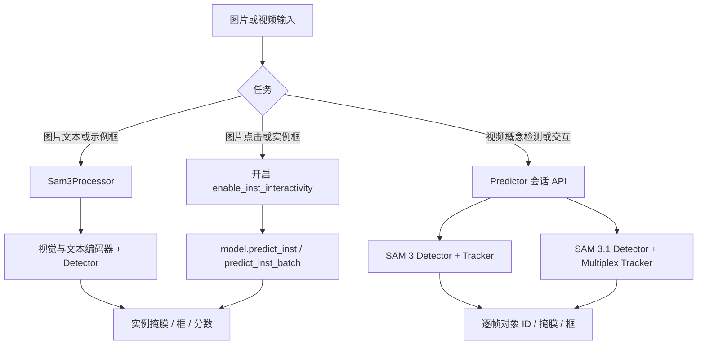

# SAM3 快速入门与现有优化

版本基线：`Alwaysssssss/sam3@6dab22eb529aa39c8e93c3451d2b289faf546fd4`。本文仅为静态代码梳理；本轮不配环境、不测试。

## 1. 先建立两个概念

**概念分割**：给一句短文本（例如 `person`），或给一个正/负框示例，让模型找到符合概念的对象。可能返回多个实例，每个实例有掩膜和框。图片主要走 detector；视频结合 detector 与 tracker。

**实例交互分割**：用点击、框或已有掩膜指定一个具体对象；后续增删正负点修正这个对象。图片是 SAM 1 风格任务，视频是 SAM 2 风格任务。它们与概念分割共用部分模型，但调用入口和提示语义不同。

业务说“点一下选中这个人”，优先查实例交互；说“找所有人”，优先查概念分割。业务说“框住这个人”，还需确认是只保留该实例，还是把这个框作为同类对象的示例。

## 2. 项目调用关系



这里的会话 API 是 Python 方法，尚未封装成 HTTP 服务。

## 3. 按业务选择入口

| 场景 | 首选入口 | 先看哪个示例 |
|---|---|---|
| 图片，输入文字找对象 | `build_sam3_image_model` + `Sam3Processor.set_text_prompt` | [图片概念分割](https://github.com/Alwaysssssss/sam3/blob/6dab22eb529aa39c8e93c3451d2b289faf546fd4/examples/sam3_image_predictor_example.ipynb) |
| 图片，正负点击选对象、修边 | `enable_inst_interactivity=True` + `model.predict_inst` | [SAM 1 风格图片任务](https://github.com/Alwaysssssss/sam3/blob/6dab22eb529aa39c8e93c3451d2b289faf546fd4/examples/sam3_for_sam1_task_example.ipynb) |
| 图片，拖框指定对象 | `model.predict_inst(box=...)` | 同上 |
| 图片，用正负示例框找同类对象 | `processor.add_geometric_prompt` | 图片概念分割示例 |
| 视频，用文字/示例框检测并持续跟踪 | `build_sam3_video_predictor` 或显式选择版本的 `build_sam3_predictor` | [SAM 3 视频](https://github.com/Alwaysssssss/sam3/blob/6dab22eb529aa39c8e93c3451d2b289faf546fd4/examples/sam3_video_predictor_example.ipynb)、[SAM 3.1 视频](https://github.com/Alwaysssssss/sam3/blob/6dab22eb529aa39c8e93c3451d2b289faf546fd4/examples/sam3.1_video_predictor_example.ipynb) |
| 视频，用点击指定或修正具体对象 | 会话 `add_prompt(points=..., obj_id=...)` | 同上 |
| 视频，直接用框初始化指定 ID 的实例 | 底层 `sam3_model.tracker.add_new_points_or_box` | [SAM 2 风格视频任务](https://github.com/Alwaysssssss/sam3/blob/6dab22eb529aa39c8e93c3451d2b289faf546fd4/examples/sam3_for_sam2_video_task_example.ipynb) |
| 复杂指令，如需要推理才能确定对象 | `sam3.agent.inference.run_single_image_inference`，还需外部多模态模型 | [Agent 示例](https://github.com/Alwaysssssss/sam3/blob/6dab22eb529aa39c8e93c3451d2b289faf546fd4/examples/sam3_agent.ipynb) |

`build_sam3_predictor()` 的默认版本是 **SAM 3.1**；`build_sam3_video_predictor()` 是 **SAM 3**。后续调用建议显式写 `version="sam3"` 或 `version="sam3.1"`，并配套相应权重，避免仅凭函数名称理解版本。[构建入口](https://github.com/Alwaysssssss/sam3/blob/6dab22eb529aa39c8e93c3451d2b289faf546fd4/sam3/model_builder.py#L1246)

## 4. 最短源码阅读路线

| 顺序 | 文件 | 读完要回答的问题 |
|---|---|---|
| 1 | [model_builder.py](https://github.com/Alwaysssssss/sam3/blob/6dab22eb529aa39c8e93c3451d2b289faf546fd4/sam3/model_builder.py) | 构建图片、SAM 3 视频、SAM 3.1 视频分别用什么函数？哪些参数控制版本与优化？ |
| 2 | [sam3_image_processor.py](https://github.com/Alwaysssssss/sam3/blob/6dab22eb529aa39c8e93c3451d2b289faf546fd4/sam3/model/sam3_image_processor.py) | 图片如何缓存视觉特征、添加文字和框、输出掩膜？ |
| 3 | [sam3_image.py 的 predict_inst](https://github.com/Alwaysssssss/sam3/blob/6dab22eb529aa39c8e93c3451d2b289faf546fd4/sam3/model/sam3_image.py#L628) + [sam1_task_predictor.py](https://github.com/Alwaysssssss/sam3/blob/6dab22eb529aa39c8e93c3451d2b289faf546fd4/sam3/model/sam1_task_predictor.py#L234) | 点击、实例框、低分辨率 mask logits 如何进入图片实例分割？ |
| 4 | [sam3_base_predictor.py](https://github.com/Alwaysssssss/sam3/blob/6dab22eb529aa39c8e93c3451d2b289faf546fd4/sam3/model/sam3_base_predictor.py#L55) | 会话有哪些操作？请求字段和响应长什么样？ |
| 5 | [sam3_video_inference.py 的实例交互](https://github.com/Alwaysssssss/sam3/blob/6dab22eb529aa39c8e93c3451d2b289faf546fd4/sam3/model/sam3_video_inference.py#L1478) | 视频文字/框与点击为何分两条分支？`obj_id` 怎样使用？ |
| 6 | [sam3_multiplex_tracking.py](https://github.com/Alwaysssssss/sam3/blob/6dab22eb529aa39c8e93c3451d2b289faf546fd4/sam3/model/sam3_multiplex_tracking.py#L2693) | SAM 3.1 如何进行多对象联合跟踪，哪些参数不同？ |

先结合对应 notebook 读这些入口；再按需要进入视觉编码器、检测器、tracker 内部。训练和评测暂时后置。

## 5. 当前 main 已有哪些优化

下表是“代码已提供入口/路径”，不代表此次服务器已启用或测得收益。

| 已有机制 | 作用 | 当前入口或开关 | 本轮证据与限制 |
|---|---|---|---|
| 图片视觉特征复用 | 同一图片多次提示时复用 backbone 特征 | `Sam3Processor.set_image` 保存 `state["backbone_out"]`，后续提示复用 | 已静态确认；更换图片需更新 state |
| BF16 推理、inference mode、TF32 | 减少推理开销，利用合适的 GPU 算力 | 视频会话 `add_prompt` 中 BF16 autocast；多个推理方法有装饰器；构建器及 multiplex predictor 设置 TF32 | 已静态确认；各路径覆盖不同，非全模型统一精度承诺 |
| `torch.compile` | 编译适合的模型组件 | 图片和视频构建器的 `compile`；SAM 3.1 另有 `warm_up` | 多个公共构建器默认 `compile=False`；本轮未编译或预热 |
| SAM 3.1 Object Multiplex | 将多个对象放入桶联合跟踪，减少逐对象重复计算 | `build_sam3_multiplex_video_predictor`；`max_num_objects`、`multiplex_count` 默认均为 16 | 官方已有能力；权重不同；未评估业务对象数与效果 |
| SAM 3.1 批量 grounding / 后处理 | 增加同批工作量、减少部分同步 | 构建代码设置 `use_batched_grounding=True`；tracker 中有批量后处理路径 | 单帧 `add_prompt` 会临时关闭 batched grounding；不能据此声称所有调用均批处理 |
| FlashAttention-3 路径 | 可选 attention 实现 | SAM 3.1 公共构建器 `use_fa3=True` 默认；部分内部构建函数也有开关 | 硬件与依赖兼容性未核验；普通图片构建器未直接公开这个参数 |
| 多 GPU 视频协同 | 多进程协作处理视频对象 | `build_sam3_video_predictor(gpus_to_use=[...])` -> `Sam3VideoPredictorMultiGPU` | SAM 3 默认只用当前 GPU；这与独立请求多 worker 吞吐扩展不同 |
| 异步帧加载 / 可选解码器 | 与推理重叠部分加载工作 | `async_loading_frames`；SAM 3 predictor 的 `video_loader_type="cv2" / "torchcodec"` | SAM 3 默认异步关闭；统一构建入口默认开启；SAM 3.1 公共构建器不接受同样的全部参数 |
| CPU offload | 以传输/CPU 开销换取显存空间 | `start_session` 的 `offload_video_to_cpu`、`offload_state_to_cpu` | 属于资源权衡，非保证加速；各路径的节省量未测 |
| 逐帧结果驱逐与会话释放 | 减少缓存结果和已关闭会话占用 | 流请求 `evict_cached_frame_outputs=False` 默认；`close_session` 显式清理 state，并按显存压力决定 empty_cache | 源码已存在；驱逐缓存可能影响后续交互复用，需要业务确认 |
| 图片批推理 | 一次处理多图/多查询 | `predict_inst_batch`；概念分割使用 notebook 的 `model(batch)` + `PostProcessImage` | 无自动 HTTP 动态微批服务；不要把 `set_image_batch` 直接接单图 `set_text_prompt` |

优化入口主要来自 [model_builder.py](https://github.com/Alwaysssssss/sam3/blob/6dab22eb529aa39c8e93c3451d2b289faf546fd4/sam3/model_builder.py)、[视频公共基类](https://github.com/Alwaysssssss/sam3/blob/6dab22eb529aa39c8e93c3451d2b289faf546fd4/sam3/model/sam3_base_predictor.py)、[视频解码](https://github.com/Alwaysssssss/sam3/blob/6dab22eb529aa39c8e93c3451d2b289faf546fd4/sam3/model/io_utils.py)、[SAM 3.1 跟踪器](https://github.com/Alwaysssssss/sam3/blob/6dab22eb529aa39c8e93c3451d2b289faf546fd4/sam3/model/sam3_multiplex_tracking.py)。不将上游文档中其他 GPU 的加速数字套用到这台服务器。

## 6. fork 文档与实现的区别

通过 Git 比较，fork 相对官方 `f1647e8...` 的净差异为 30 个新增 Markdown 文件，全部位于 `docs/` 与 `deploy/`。其中 [sam3-inference-optimization.md](https://github.com/Alwaysssssss/sam3/blob/6dab22eb529aa39c8e93c3451d2b289faf546fd4/deploy/sam3-inference-optimization.md) 是优化方案，描述了 HTTP 服务、动态微批、TensorRT、量化、监控等拟建设计。

当前树中没有其规划的 `deploy/http_service.py`、`deploy/http_runtime.py`、ONNX/TRT 导出脚本或配套服务 Dockerfile；没有发现 FastAPI/Flask 路由实现。该文档还有对 WebSocket 范围前后不一致的描述，因此不以它直接定义对外协议。`sam3.agent.client_sam3.call_sam_service` 虽然名字含 service，当前实现仍直接调用本地 `sam3_inference`。

源码对比：[固定版本比较](https://github.com/Alwaysssssss/sam3/compare/f1647e8d0c1d280991f4d1b7d974c2704537fe66...6dab22eb529aa39c8e93c3451d2b289faf546fd4)。可复核命令：

```powershell
ssh L40s-videoedit-zchenze 'git -C /home/chenze/sam3 diff --stat f1647e8d0c1d280991f4d1b7d974c2704537fe66 6dab22eb529aa39c8e93c3451d2b289faf546fd4'
```

## 7. 当前阶段怎样推进最省力

先用 02 的矩阵确定部门各自需要的 2—3 条业务路径，再补最小调用封装和环境。图片交互、视频单实例跟踪、视频同类对象检测的状态和输出契约不同；先统一这些约定，再决定是否需要 HTTP、WebSocket、批量化或后续性能优化。

本轮只完成代码落地、静态接口梳理和需求对接准备。功能验证、质量评估、性能基线和新增优化均未开始。
